# A Crew of AI Agents Runs My Homelab

One morning recently my phone buzzed at 9 a.m. with a message from my homelab. It said the backup drive was 82% full, that fifteen old backups were sitting there with nothing set up to clean them out, and that one of the media disks was at 80% and climbing. It listed what it had found, said what it would do about each, and asked if I wanted it to go ahead.

I read it over coffee and said yes. The space came back.

I didn't open a dashboard or SSH into anything, and I didn't have to remember which job wrote those backups. I've run this homelab for years and I'm not sure I'd have noticed that drive filling up before it actually filled up. That's the reason I built this.

What I have now is a small crew of AI agents that handles the day-to-day running of my servers. I make the decisions and they do the legwork. This post covers how it fits together, which models do which job, and what I'd do the same or differently if I started again. I've left out configs, addresses and anything else that would help someone find my house, because the ideas are the useful part.

## What's an AI harness?

A language model on its own can answer questions, but it can't check a server, read a log or do anything in the world.

The harness is everything you build around the model so it can. It decides which tools the model gets, what it remembers between conversations, what it's forbidden to touch and how it reaches you. It also handles the dull parts, like schedules, retries, budgets and switching to another model when one is down.

People spend a lot of time arguing about which model is best and very little on the harness, even though that's where most of the engineering goes. A strong model inside a careless harness is a quick way to delete something you needed.

## Why ZeroClaw

I tried a few agent frameworks before settling on ZeroClaw. Some wanted to own my whole stack. Others made a great ten-minute demo and then fell over the first time something unexpected happened.

ZeroClaw is small and runs on my own hardware, in a container, so my data stays at home. It was built for several agents with different jobs, and each one can have its own permissions and its own model. The safety features I care about are part of it rather than something I had to bolt on: risk levels, a list of commands each agent may run, a cap on actions per hour, and approval flows. It also schedules jobs and talks to me through a chat app, which covered the rest.

Mostly, though, I picked it because it's boring. It starts, it runs, it comes back after a restart. For something that's supposed to keep an eye on my servers at 3 a.m., that matters more than any feature list.

## What I actually wanted

I didn't want an AI that does everything. I've seen where that ends up.

I wanted something closer to a careful colleague. It should look at everything and change very little without asking. It should tell me when it doesn't know something instead of guessing to sound helpful. It shouldn't cost much, it should get better over time, and it should do real work instead of looking impressive in a screenshot.

## Meet the crew

I named the agents after the AI sidekicks from a certain billionaire's workshop. If I'm going to talk to my infrastructure every day, it might as well have some personality.

I only ever talk to **EDITH**. She's the orchestrator: she works out what I'm asking for, hands it to the right specialist and brings back one answer instead of four. She never touches the servers herself.

**FRIDAY** watches things. Health, stats, logs, backups, disk space. She's strictly read-only, and every report ends with a one-line verdict so I can skim.

**VERONICA** runs the media side: what's in the library, what's new, what's stuck, what someone has requested.

**JARVIS** looks after identity and access, meaning accounts, groups and who gets in where. He asks before he changes anything.

**DUM-E** is the builder. In the films he's the clumsy robot arm that sprays the fire extinguisher at everyone. Mine is fully enabled and working, and it's a lot less chaotic than the original. It does the hands-on build work under the same rules as the rest of the crew.

## Which models run which agent

This is the question I'd have wanted answered when I started, so here it is plainly.

| Job | Model | Why |
|---|---|---|
| EDITH, the orchestrator | **Claude Sonnet 5.5** (Anthropic) | She does the thinking: understanding vague requests, picking who should handle them, deciding what an answer means. That's where a stronger model pays for itself. |
| FRIDAY, VERONICA, JARVIS, DUM-E | **Gemini 3.7 Flash** (Google) | Their work is mostly "run the tool, read the output, report back". A fast, cheap model does that well. |
| Alert triage and log summaries | **Gemini 3.1 Flash-Lite** (Google) | Sorting and summarising is simple work, so it goes to the smallest model I have. |

Using two vendors is deliberate. It keeps the bill down, and it means one provider having a bad day doesn't take everything with it, which I'll come back to.

One thing I learned the hard way: the very smallest models are good at summarising and bad at driving tools. In my setup they'd write a tool call out as plain text and never actually run it. So Flash-Lite only sorts and summarises. It never operates anything.

## How it all fits together

Here's the whole picture. Follow the moving dashes.

It reads left to right, and I'll walk through one request.

I send a message in Telegram. It lands in the **ZeroClaw gateway**, which is the container that hosts all the agents. EDITH reads it, asks Claude what to do, and hands the job to the right specialist. That specialist calls Gemini to work out the details.

Then comes the part I care about most. The specialist doesn't get a terminal. It can only call the **toolbox**, a set of purpose-built commands: show stats, show backup status, read a container's logs, look up the media library, and so on. Each command does one job, refuses odd input and strips secrets from its output.

The toolbox reaches the homelab through three narrow paths. One is the **Proxmox API**, using a read-only token. One is an **SSH gate**, a locked-down login that can only run a short list of approved actions and nothing else. The third is the **APIs of the apps themselves**: Jellyfin, Jellyseerr, Authentik and Netdata.

Approvals mostly happen right in the Telegram chat. When something needs my say-so, EDITH posts what she wants to do with **Approve** and **Deny** buttons, and nothing happens until I tap one. For the riskiest changes there's a second check along the bottom: a one-time code sent over a separate private ntfy channel, which I have to send back before the action runs. At the top are the **model providers**, lined up in the order they take over when the one before goes down.

Two boxes inside the gateway don't take part in a request. **Playbooks and memory** hold the skills and runbooks the agents read, plus the lessons from the weekly review. **Guardrails** hold the risk profiles, the command allowlist and the hourly action cap. They're what keeps the whole thing in bounds.

## What they actually do

Some of it runs on a schedule and some of it happens when I ask.

Every morning there's a briefing: what ran overnight, what failed, what needs a decision. During the day, alerts get sorted so only the ones worth interrupting me for reach my phone. When I'm curious about something ("how are the servers doing?", "what's new in the library?", "add that movie"), I ask in the same chat and the right agent picks it up. If something breaks, the agent proposes a fix. Small fixes it can make on its own within limits, and bigger ones wait for me. Afterwards it checks the app actually came back, because "I ran the command" and "it worked" are different statements.

Here's roughly what a conversation looks like, lightly edited:

> **Me:** are my backups ok?
>
> **EDITH:** Checking with FRIDAY.
>
> **EDITH:** Mostly good. 21 of 22 systems have a backup from the last day. The router's is six days old, but that's its weekly schedule, so it's fine. One system has no backup I can actually prove from the logs. I'm calling that unknown, not fine. Want me to dig in?

That last bit matters more than it looks. Early on, it filled gaps with confident guesses. Teaching it to say "unknown" was the most useful change I made.

There's also a weekly review where the crew looks back over its own week and writes down what it learned, which it reads next time. It's early days for that part, so I won't oversell what it has taught itself so far.

## Why delegate instead of one big agent

The tempting design is a single super-agent with every tool and every permission. I'd talk you out of it.

A narrow job means short instructions, and short instructions mean fewer mistakes. It also keeps the damage small when something does go wrong. FRIDAY can't delete anything because she has no way to, and JARVIS can't restart a service. Routine work doesn't need the most expensive model, which is the whole reason for the split above. And when one agent misbehaves I know exactly which one to fix, instead of untangling a four-thousand-word prompt.

It's the same reason you don't give the intern the root password. Nobody thinks the intern is bad, but the setup shouldn't depend on it.

## Why this is the right pattern

If I had to compress the design into one sentence, it would be: **give the AI judgement, not authority.**

The model decides what's worth doing. A plain, deterministic layer decides whether it's allowed. The model can be as creative as it likes, because the rules aren't written in its prompt where it could talk itself around them. They're enforced somewhere it can't reach.

Two decisions carry most of the weight. First, the agents don't get a shell at all, only the toolbox, so you can't trick an agent into running something it was never given. Second, access is narrow on purpose: each agent connects through a path that allows a short list of actions on specific machines, and the read-only agent's credentials really are read-only.

## How the bill stays small

My rule is that every question goes to the cheapest thing that can answer it properly.

Plenty of questions don't need a model at all. If a script can work out whether a disk is over 80% full, it does, and that costs nothing. Routine jobs go to Gemini 3.7 Flash, and sorting and summarising goes to Flash-Lite. Claude is kept for the thinking. Instructions that never change are cached, so I'm not paying to re-read the same playbook with every message, and there's a cap on actions per hour so a runaway loop gets stopped before it gets expensive.

I'm not going to quote my bill, because it moves around and would date this post. What I can say is that the split above is what keeps it from being alarming.

## The fallback plan

Models go down. APIs get rate-limited. Providers have bad days. If everything depended on one vendor, I'd have swapped a single point of failure on a server for one on a subscription.

So there's an order. Claude goes first. If it's unavailable, the request moves to Gemini, then to OpenRouter, a marketplace that fronts many providers, and finally to a LiteLLM gateway that I host myself. That last step is the one I'm still finishing, so right now I'd call the chain three deep with a fourth on the way. I still get an answer when one fails. It might just read less well.

## Human in the loop

This is the part I'm proudest of, and the reason I'm comfortable leaving it running.

Every action is sorted into one of three tiers by a policy, not by the AI's judgement in the moment.

| Tier | What it covers | Who decides |
|---|---|---|
| **0, look** | Read-only things: stats, logs, status | The agent, whenever it likes |
| **1, small fix** | Low-risk, reversible things like restarting a misbehaving app, a few times an hour at most, every one logged | The agent, inside strict limits |
| **2, needs me** | Anything bigger | Me. Most of the time that's an Approve or Deny tap in the Telegram chat. The riskiest restarts also need a one-time code, sent to my phone over a separate channel, which expires after a few minutes and allows only a few tries |

On top of that there's a list of things no agent may restart, ever, like databases. No clever phrasing changes that, because the rule isn't in the prompt. And after any change, the agent checks that it worked and tells me, rather than just saying it's done.

## What went wrong

Plenty did, which is why I trust it more now.

Early on I asked about the media server and an agent told me nobody was watching anything, because the CPU was quiet. It had no way of knowing that. It was guessing and presenting the guess as a fact. Now it reads actual session data, and "never infer what you can look up" is written into its instructions.

The backup checker was worse. It reported nearly every system as missing a backup. The backups were fine. The agent's read-only access just couldn't see them, and my tool had treated "I can't see it" as "it doesn't exist". That's where the unknown rule came from. Now it reads the job logs as evidence, and when it can't prove something it says so.

And one deploy quietly failed because of a line-ending difference between Windows and Linux, so a new command the agent needed was silently refused. Nothing crashed. I only found out because I tested it with a real question, which taught me to check that a change actually landed.

Each of these became a rule, a test or a note the crew reads.

## What it can't do, deliberately

It won't make a serious change without a code from me. It won't touch the databases. It won't give me a confident answer it can't back up, and it never gets to see my secrets. I used to think of those as limitations, but they're what make it safe to leave running.

## What's more, once you have the platform

The first agent is the hard one. After that, every idea is a small step, because the harness, the guardrails and the chat are already there, and a new capability is just another role with another narrow toolbox.

I'm looking at smart-home awareness, so the house and the lab can see each other, and at alerts that get smarter about what deserves my attention. The agents already search my own documentation, so "how did I set this up again?" has an answer. I also run self-tests after changes to check the whole crew still behaves, and more specialists (networking, security reviews, cost reports) are an obvious next step. None of them need new plumbing.

If I started over, I'd begin read-only and let the agents earn trust before giving them anything that can change state. I'd build commands rather than hand over a shell. I'd treat "I don't know" as a perfectly good answer, and I'd put a human on the small slice of actions that can really hurt. Everything else I'd automate.

My homelab used to be something I maintained. Now it's something I supervise, which is a better job. If you build your own crew, I'd like to hear what you call them.
